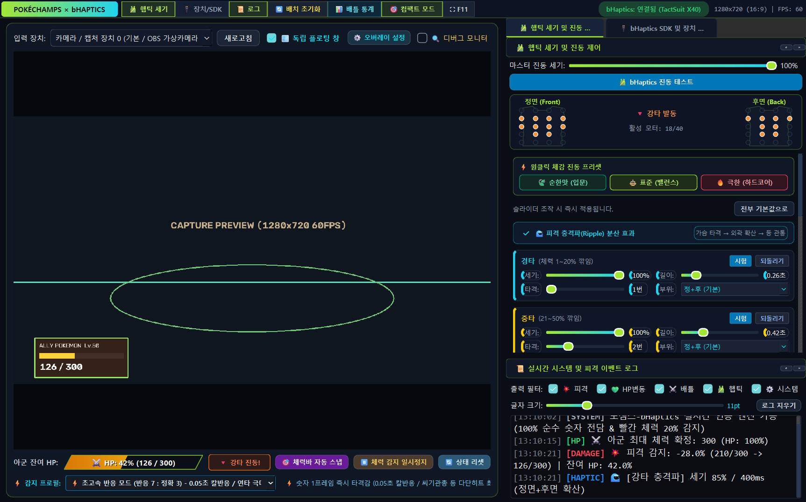
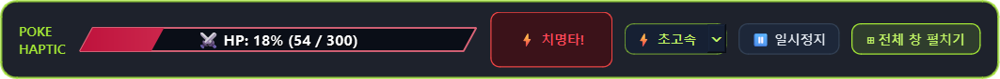

# PokéChamps x bHaptics Tactile Link v3.0 (포챔스 x bHaptics 실시간 연동 시스템)

<p align="center">
  
  
  
  
  
  
  
</p>

닌텐도 스위치 포켓몬 챔피언스(포챔스) 게임 화면을 캡처보드 또는 OBS 가상 카메라로 실시간 캡처하여, **아군 포켓몬의 피격 데미지 비율(%)과 상태에 비례하는 생생한 입체 햅틱 피드백을 bHaptics TactSuit 슈트로 전달**하는 고성능 비전-햅틱 연동 시스템입니다.

---

## 📸 UI 미리보기 (Screenshots)

### 1. 전체 대시보드 — 포챔스 SV 글래스모피즘 테마 (기본 모드)
> 딥 네이비 글래스 카드, 일렉트릭 라임/시안 액센트, 사선 HP 게이지, 2단 탭 도킹 패널, 40채널 실시간 조끼 프리뷰 및 원클릭 체감 프리셋을 제공합니다.

<p align="center">
  
</p>

### 2. 실전 집중 컴팩트 모드 — 초슬림 컨트롤 바 (`🎯 컴팩트 모드` 전환)
> 상단 툴바의 **`🎯 컴팩트 모드`** 버튼을 누르면 메인 대시보드를 숨기고 화면 위 원하는 위치에 초슬림 HUD 컨트롤 바(`850×68`)만 띄워 게임 화면에 온전히 집중할 수 있습니다. **`⊞ 전체 창 펼치기`**로 언제든 복귀합니다.

<p align="center">
  
</p>

---

## 📑 목차 (Table of Contents)
- [✨ 핵심 기능 (Key Features)](#-핵심-기능-key-features)
- [🛠️ 요구 사양 및 준비물](#️-요구-사양-및-준비물)
- [🚀 설치 및 빠른 시작 (Quick Start)](#-설치-및-빠른-시작-quick-start)
- [🎮 상세 사용법 가이드 (User Guide)](#-상세-사용법-가이드-user-guide)
- [❓ 자주 묻는 질문 및 문제 해결 (FAQ & Troubleshooting)](#-자주-묻는-질문-및-문제-해결-faq--troubleshooting)
- [⚙️ 설정 파라미터 안내 (Configuration)](#️-설정-파라미터-안내-configuration)
- [🏗️ 개발자 아키텍처 가이드 (Architecture)](#️-개발자-아키텍처-가이드-architecture)
- [📜 라이선스 (License)](#-라이선스-license)

---

## ✨ 핵심 기능 (Key Features)

### 1. 🎨 포챔스 SV 글래스모피즘 UI & 컴팩트 모드 전환
* **사선 HP 게이지 (`SlantedHpBarWidget`)**: 포켓몬 배틀 카드 감성의 사선 게이지를 통해 잔여 HP 비율과 일시정지/컷신 대기 상태를 직관적으로 표시합니다.
* **2단 탭 도킹 레이아웃**: 우측 상단에 `햅틱 세기 제어`와 `bHaptics SDK 설정`을 탭으로 결합하고, 하단에 `실시간 이벤트 로그`를 배치해 화면 밀도를 최적화했습니다.
* **실전 집중 컴팩트 모드 (`CompactHudWindow`)**: 툴바의 **`🎯 컴팩트 모드`** 버튼 하나로 초슬림 플로팅 바 모드로 전환하며, 드래그 위치(`compact_mode_x`, `compact_mode_y`)가 자동 저장됩니다. 감지 프로필과 일시정지 상태는 메인 창과 실시간 양방향 동기화됩니다.

### 2. 🎯 100% 순수 숫자 OCR 전담 파이프라인 & 3단계 감지 프로필
* **경기장 조명 간섭 완벽 제거**: 반투명 배틀 카드 뒤로 경기장 바닥 LED 조명이 투과될 때 발생하던 색상 게이지 왜곡을 없애기 위해, 게이지 개입을 완전히 제거하고 **OCR 숫자(`현재HP / 최대HP`) 단일 진실 판정**으로 통합했습니다.
* **실시간 3단계 감지 프로필**:
  * `⚡ 초고속 (7:3)`: 1프레임 즉각 타격감 (씨기관총·고드름침 등 다단히트 최적화)
  * `⚖️ 균형 (6:4 권장)`: 최대 HP 일치 시 즉시 발동 + 포켓몬 교체 시 2프레임 보호
  * `🎯 고정밀 (8.5:1.5)`: 2프레임 연속 합의 후 발동 (오작동 0% 중계·대회용)
* **다층 오독 방어막**: 한 자리 숫자 앞자리 유령 숫자(`9197`, `91197`) 방어, 타이머(`MM:SS`) 블랙리스트 필터링, 스킬 연출 중 OCR 조기 동결(Cutscene Hold), 캡처 장치 연결/단절 실시간 감지를 지원합니다.

### 3. 🌊 입체 파동형 충격파(Ripple) & 원클릭 체감 프리셋
* **원클릭 체감 프리셋**: **`🍃 순한맛 (입문)`** · **`⚖️ 표준 (밸런스)`** · **`🔥 극한 (하드코어)`** 버튼 한 번으로 전체 진동 세기·지속시간·타격횟수를 일괄 전환할 수 있습니다.
* **입체 파동형 충격파 (`enable_ripple_effect`)**: 중타(2단계)·강타(3단계)·치명타(4단계) 피격 시 명치 코어에서 외곽과 등 뒤로 진동이 퍼져 나가는 다단계 충격파 햅틱을 제공합니다.
* **연속기 버스트 선점 & 부위 커스텀**: 후속타·기절 발생 시 이전 버스트 잔여 대기열을 즉시 양보해 타격 반응 지연을 없애며, 모든 카드에서 **`[정+후 / 정면만 / 후면만]`**을 독립 지정할 수 있습니다.

### 4. 🩸 동적 빨간 체력(20% 이하) 심장박동 & 📊 배틀 통계
* **동적 BPM 심장박동**: 체력 20% 이하 진입 시 잔여 체력이 낮아질수록 심장박동 속도가 자연스럽게 빨라지며, 화려한 연출 중에도 최대 **8.0초**까지 끊김 없이 유지됩니다.
* **실시간 배틀 통계 대시보드**: 상단 툴바 **`📊 배틀 통계`**에서 누적 데미지, 회복량, 기절/교체 횟수, 타격 등급 분포를 즉시 확인할 수 있습니다.

---

## 🛠️ 요구 사양 및 준비물

* **게임 환경**: 닌텐도 스위치 및 포켓몬 챔피언스 (PokéChamps)
* **비디오 캡처**: HDMI 캡처보드 (Elgato, AVerMedia 등) 또는 OBS Studio 가상 카메라
* **햅틱 장비**: bHaptics TactSuit (TactSuit X40, TactSuit X16, Tactosy 등)
* **운영체제**: Windows 10 / 11 (64-bit)
* **필수 소프트웨어**: [bHaptics Player](https://www.bhaptics.com/) 설치 및 실행 필수

---

## 🚀 설치 및 빠른 시작 (Quick Start)

### 방법 1: 독립 실행 파일(.exe)로 즉시 실행하기 (가장 추천 ⭐)
1. [GitHub Releases](https://github.com/ManofKimchi08/pochams-bhaptics/releases)에서 최신 릴리즈 압축 파일(`Pochams_bHaptics_v3.0.0_Windows.zip`)을 다운로드하고 압축을 해제합니다.
2. 폴더 내 `Pochams_bHaptics.exe`를 실행합니다.

### 방법 2: Python 소스 코드로 직접 실행하기
```bash
# 1. 저장소 복제
git clone https://github.com/ManofKimchi08/pochams-bhaptics.git
cd pochams-bhaptics

# 2. 필수 의존성 설치
pip install -r requirements.txt

# 3. 애플리케이션 시작 (또는 run.bat 실행)
python main.py
```

---

## 🎮 상세 사용법 가이드 (User Guide)

1. **bHaptics Player 켜기**:
   - PC에서 bHaptics Player를 실행하고 TactSuit 슈트가 블루투스 또는 동글로 연결되었는지 확인합니다.
2. **프로그램 실행 및 입력 장치 선택**:
   - `Pochams_bHaptics.exe` 또는 `run.bat` 실행 후, 상단 `[입력 장치]`에서 캡처보드 또는 OBS Virtual Camera를 선택합니다.
3. **체력바 영역 지정**:
   - **자동 스냅 (추천)**: 배틀 화면이 띄워진 상태에서 **`[ 🎯 체력바 자동 스냅 ]`** 버튼을 클릭합니다.
   - **수동 지정**: 마우스 왼쪽 드래그로 좌하단 아군 체력바 카드(`현재HP / 최대HP` 포함)를 직접 지정합니다.
4. **프리셋 및 감지 프로필 선택**:
   - 우측 `햅틱 세기 제어`에서 **`순한맛 / 표준 / 극한`** 프리셋을 고르거나 각 카드를 미세 조정합니다.
   - 하단 `감지 프로필`에서 플레이 스타일에 맞게 **`초고속 / 균형 / 고정밀`** 모드를 선택합니다.
5. **실전 집중 모드 활용**:
   - 게임 화면에 집중하고 싶을 때는 상단 **`[ 🎯 컴팩트 모드 ]`**를 눌러 슬림 컨트롤 바만 남겨두고, 전체 화면 전환은 **`F11`** 키를 사용하세요.

---

## ❓ 자주 묻는 질문 및 문제 해결 (FAQ & Troubleshooting)

#### Q1. 진동이 전혀 오지 않아요.
* **확인 1**: PC에서 **bHaptics Player**가 켜져 있고 수트가 페어링되어 있는지 확인하세요.
* **확인 2**: 우측 패널의 `[🎽 bHaptics 진동 테스트]` 또는 각 카드의 `[시험]` 버튼으로 정상 동작을 먼저 확인하세요.
* **확인 3**: 체력바 숫자가 잘려 있지 않은지 확인하고 `[ 🎯 체력바 자동 스냅 ]`을 다시 눌러주세요.

#### Q2. 비디오 화면이 검은색으로 나와요.
* OBS 등 다른 방송 프로그램이 캡처보드를 독점 중일 수 있습니다.
* OBS에서 **[가상 카메라 시작 (Start Virtual Camera)]**을 켠 뒤, 본 프로그램 `[입력 장치]`에서 **"OBS Virtual Camera"**를 선택하세요.

#### Q3. 체력 숫자 1자리(예: HP 9)나 컷신 중에 오인식이 일어나지 않나요?
* v3.0부터 1D 색상 게이지 간섭을 완전히 제거하고 **100% 순수 OCR 숫자 판정**, 한 자리 숫자 앞자리 오독 방지, 연출 중 체력 동결 보호막이 적용되어 안정적으로 동작합니다.

---

## ⚙️ 설정 파라미터 안내 (Configuration)

`config.json` 파일을 통해 고급 설정을 직접 튜닝할 수 있으며, GUI 변경 시 자동 저장됩니다:

| 파라미터 | 기본값 | 설명 |
|---|---|---|
| `detection_mode` | `"balanced"` | 감지 프로필 (`"fast"` / `"balanced"` / `"accurate"`) |
| `min_damage_threshold` | `3.0` | 진동을 발생시킬 최소 데미지 기준 (%) |
| `master_intensity` | `100` | 전체 마스터 진동 세기 (`0 ~ 100`) |
| `red_hp_threshold` | `20.0` | 빨간 체력(심장박동/상시루프) 활성화 기준 잔여 체력 (%) |
| `log_font_size` | `11` | 이벤트 로그 창 글자 크기 (pt) |
| `show_floating_overlay` | `true` | 독립 플로팅 HUD 창 활성화 여부 |
| `compact_mode_x`, `compact_mode_y` | `180`, `36` | 컴팩트 컨트롤 바 마지막 화면 좌표 |
| `haptic_details.enable_ripple_effect` | `true` | 중타/강타/치명타 입체 충격파 확산 효과 사용 여부 |

---

## 🏗️ 개발자 아키텍처 가이드 (Architecture)

시스템 내부 아키텍처, 비동기 멀티스레딩 모델, Pure OCR 전처리 파이프라인, 모터 매트릭스 알고리즘에 대한 자세한 기술 문서는 [**`ARCHITECTURE.md`**](ARCHITECTURE.md)와 [**`docs/`**](docs/README.md)를 참조하세요.

---

## 📜 라이선스 (License)

This project is licensed under the MIT License - see the [LICENSE](LICENSE) file for details.  
* All Pokémon assets and trademarks are the property of Nintendo, Creatures Inc., and GAME FREAK inc.  
* bHaptics is a registered trademark of bHaptics Inc.
